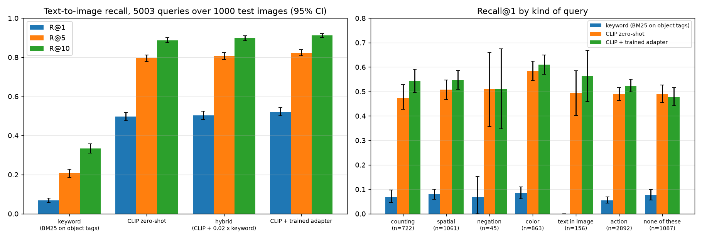

# clipsearch — How Good Is AI Image Search, and Where Does It Fail?

An evaluation of text-to-image search on real photos and real human queries. It compares four ways to find a
photo from a description:

- **keyword search** over each image's object tags (the way a stock library with curated keywords works)
- **zero-shot CLIP** (OpenAI ViT-B/32) embeddings
- a **hybrid** of the two
- **CLIP with a small trained adapter**

Every comparison is reported with a bootstrap confidence interval, and queries are broken down by the kind of
language that trips models up.

Data: COCO val2017, 5,000 photos, each with about five human-written captions (used as search queries) and object
annotations (used as keyword tags). Images are split by id into 3,000 train, 1,000 validation and 1,000 test; no
image or caption crosses splits. Everything below is on the test split: 5,003 queries against 1,000 images.



## Results

| System | Recall@1 (95% CI) | Recall@5 | Recall@10 | Recall@1 vs CLIP (95% CI) |
|---|---|---|---|---|
| Keyword (BM25 on object tags) | 6.8% (5.6–8.1) | 20.8% | 33.4% | −42.9 points |
| CLIP zero-shot | 49.7% (47.6–51.9) | 79.6% | 88.7% | — |
| Hybrid: CLIP + 0.02 × keyword | 50.3% (48.1–52.4) | 80.6% | 89.8% | +0.6 (+0.0 to +1.1) |
| **CLIP + trained adapter** | **52.1% (50.0–54.3)** | **82.3%** | **91.2%** | **+2.4 (+0.6 to +4.1)** |

**What the numbers say**

- **Keyword tags miss most of what people search for.** Captions describe actions, attributes, counts and scenes,
  and tags name only objects. On queries about text in the image (signs, logos) keyword search found 0 of 156.
- **Adding keywords to CLIP barely helps.** The weight tuned on validation gained 1.2 points there, but only 0.6 on
  test, and that interval just clears zero. Most of what tags know, CLIP already knows.
- **A small adapter helps, and the gain is real.** Two 512×512 residual layers, trained on frozen embeddings of
  3,000 images, add 2.4 points of recall@1. Validation recall peaked at epoch 6 and then fell, so early stopping on
  validation (not training loss) decided when to stop.

**Where zero-shot CLIP struggles, and what the adapter fixed** (recall@1; adapter gain with paired 95% CI):

| Kind of query | Queries | Keyword | CLIP | CLIP + adapter | Adapter gain |
|---|---|---|---|---|---|
| Counting ("two dogs") | 722 | 6.9% | **47.5%** | 54.4% | **+6.9** (+2.9 to +11.2) |
| Spatial ("next to", "behind") | 1,061 | 7.9% | 50.7% | 54.8% | +4.1 (+0.8 to +7.3) |
| Actions ("-ing" verbs) | 2,892 | 5.5% | 49.0% | 52.3% | +3.3 (+1.1 to +5.5) |
| Color | 863 | 8.5% | 58.4% | 61.1% | +2.7 (−0.6 to +6.0) |
| Text in the image | 156 | 0.0% | 49.4% | 56.4% | +7.1 (−1.9 to +15.9) |
| Negation ("no", "empty") | 45 | 6.7% | 51.1% | 51.1% | 0 (too few queries to tell) |
| None of these | 1,087 | 7.6% | 48.9% | 47.8% | −1.2 (−4.4 to +1.9) |

Counting is CLIP's weakest kind of query, and it is where a little supervised training helped most; on plain
queries the adapter changed nothing measurable. `results/failures.md` lists real misses with links to the
images, for example "A plate with two slices of pizza on it" retrieving a single slice.

## Method notes

- **Honest intervals.** Each image has about five captions, so queries are correlated. Confidence intervals
  resample images with all their captions (a cluster bootstrap, 2,000 resamples), and comparisons are paired on the
  same resamples. A unit test shows that treating correlated captions as independent makes the interval less than half as wide.
- **Ties count against the system** when ranking, so a model can't look good by scoring everything equally.
- **Nothing is tuned on test.** The hybrid weight is chosen on validation; the adapter is trained on train and
  stopped on validation.
- **Two bugs the checks caught:**
  - The OpenAI CLIP weights expect QuickGELU activations. Loading them under the default config only prints a
    warning and quietly produces slightly wrong embeddings, so the model config is pinned to
    `ViT-B-32-quickgelu`.
  - The keyword baseline's plural folding turned "benches" into "benche", which a unit test caught before the
    final numbers.

## Run it

```bash
uv sync
mkdir -p data && cd data
curl -O http://images.cocodataset.org/zips/val2017.zip && unzip -q val2017.zip
curl -O http://images.cocodataset.org/annotations/annotations_trainval2017.zip && unzip -q annotations_trainval2017.zip
cd ..
uv run python -m clipsearch.evaluate     # embeds once (about 2 minutes on an M-series Mac), then about 5 seconds
uv run pytest                            # unit tests; no data or model needed
```

Outputs go to `results/`: `metrics.json` (every number above, adapter training history, hybrid tuning),
`recall.png`, and `failures.md`.

## Limitations

- COCO captions describe a scene as an annotator saw it; real search queries are shorter and messier.
- 1,000 test images is a small gallery; recall falls as the gallery grows.
- The query categories are simple keyword rules, so a category label can be wrong.
- One CLIP model (ViT-B/32). Larger models are stronger, and the adapter's gain may shrink.

## License and AI disclosure

Code under MIT (see `LICENSE`); COCO images and annotations are under their own licenses and are not included.
Built with help from Claude (Anthropic) via Claude Code; I reviewed, tested and verified the code and results.
